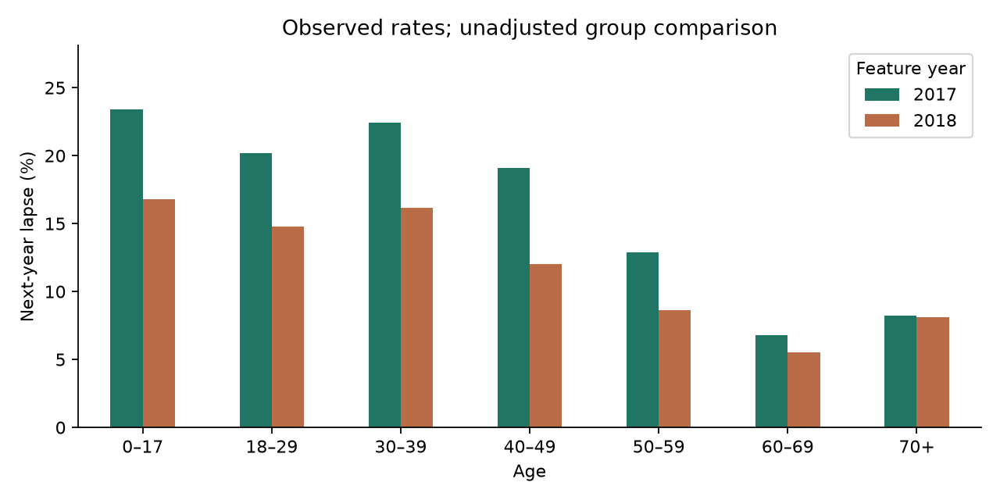
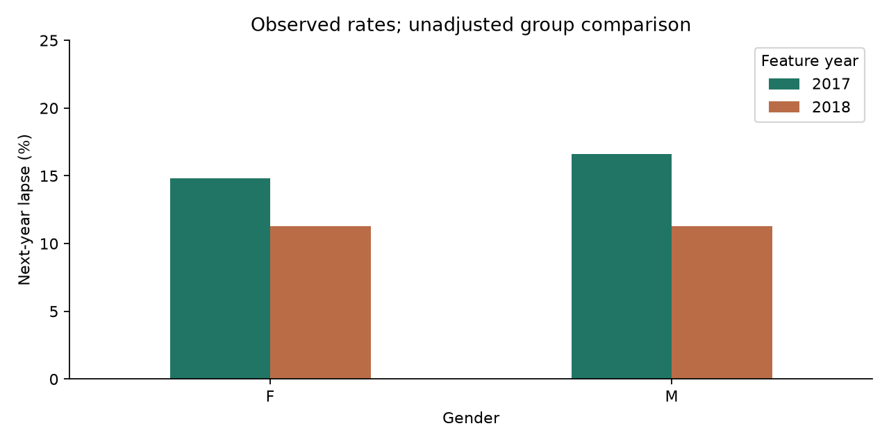
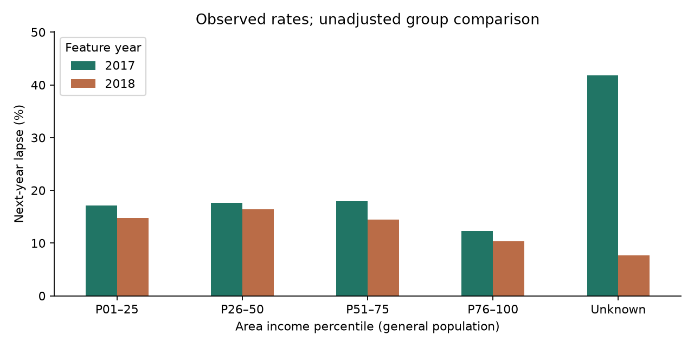
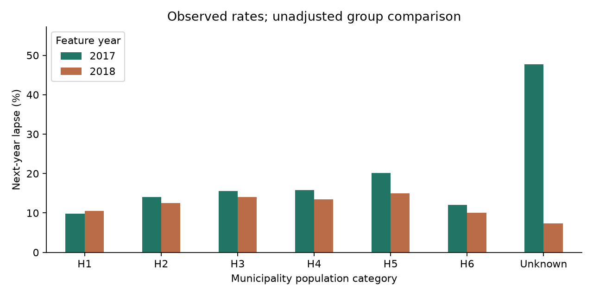

# 데이터 확보·전처리·EDA

최초 분석일: 2026년 11월 2일. 11월 6일 비교 실험에서 동일한 공개 건강보험 원본 V4로 재실행했다. 아래 EDA의 분석 범위와 결과는 유지했다.

IBEX 35 연간 가격수익률을 경제 상황 후보 변수로 연결했다. [확보 결과·연도 연결·모델 적용 한계](../docs/ibex35_context.md). 스페인 주식시장 지표이며 글로벌 경제 전체를 대변하지 않는다.

## 1. 1차 이후 변경된 내용

계약 정보 외에 나이·성별과 지역 소득·교육·인구 규모·보험 가입 밀도를 포함했다. 지역 지표는 개인 소득이나 학력이 아니다. 정의는 [분석 변수 구성](../docs/variable_specification.md)에 정리했다.

## 2. 실제 데이터와 분석 범위

원자료는 228,711행·42열이다. 기준연도 유지 중인 피보험 관계를 다음 해와 연결했다. 미확인 기록은 이탈로 간주하지 않았다. 아래 이탈 비율은 0~1 단위다.

|   feature_year |   outcome_year |          n |   unknown |    lapses |   lapse_rate |
|---------------:|---------------:|-----------:|----------:|----------:|-------------:|
|      2017.0000 |      2018.0000 | 63486.0000 |    1.0000 | 9924.0000 |       0.1563 |
|      2018.0000 |      2019.0000 | 59831.0000 |    2.0000 | 6746.0000 |       0.1128 |

## 3. 데이터 품질 확인 및 처리 기준

원자료·설명서의 체크섬을 확인하고 ID·연도 중복 0건, 상태·종료일 불일치 0건을 확인했다. 유지 상태지만 이후 연도의 종료일을 가진 행은 20,090건으로, 해당 날짜를 예측 변수에 넣으면 미래 정보가 들어갈 수 있어 제외했다.

| variable             |   missing |   missing_pct |
|:---------------------|----------:|--------------:|
| seniority_insured    |         0 |        0.0000 |
| seniority_policy     |         0 |        0.0000 |
| premium              |         0 |        0.0000 |
| type_product         |         0 |        0.0000 |
| distribution_channel |         0 |        0.0000 |
| age                  |         0 |        0.0000 |
| gender               |         0 |        0.0000 |
| C_H                  |     10886 |        4.7597 |
| C_GI                 |     13213 |        5.7772 |
| C_II                 |     13213 |        5.7772 |
| C_IE_P               |     13213 |        5.7772 |
| C_IE_S               |     13213 |        5.7772 |
| C_IE_T               |     13213 |        5.7772 |
| C_GE_P               |     13213 |        5.7772 |
| C_GE_S               |     13213 |        5.7772 |
| C_GE_T               |     13213 |        5.7772 |
| IICIMUN              |     10886 |        4.7597 |
| IICIPROV             |      5701 |        2.4927 |
| cost_claims_year     |         0 |        0.0000 |

지역 결측 행을 일괄 삭제하지 않는다. EDA에서 Unknown으로 구분하고 모델에서는 학습 자료의 중앙값·결측 표시 또는 범주형 Unknown으로 처리한다. 백분위 구간은 1~25, 26~50, 51~75, 76~100으로 고정했다. 보험료·보험 가입 밀도의 사분위 경계는 2017년 자료에서 정해 다음 해에도 적용했다. 모든 변수별 집계의 대상 수와 이탈 수가 원본 코호트와 일치하는지 검증했다.

## 4. 주요 EDA 결과

|   feature_year | variable   | group   |     n |   lapses |   lapse_rate |
|---------------:|:-----------|:--------|------:|---------:|-------------:|
|           2017 | age        | 0–17    |  9392 |     2200 |       0.2342 |
|           2017 | age        | 18–29   |  5853 |     1181 |       0.2018 |
|           2017 | age        | 30–39   |  8566 |     1922 |       0.2244 |
|           2017 | age        | 40–49   |  9856 |     1879 |       0.1906 |
|           2017 | age        | 50–59   |  9296 |     1200 |       0.1291 |
|           2017 | age        | 60–69   |  9914 |      672 |       0.0678 |
|           2017 | age        | 70+     | 10609 |      870 |       0.0820 |
|           2017 | gender     | F       | 34525 |     5110 |       0.1480 |
|           2017 | gender     | M       | 28961 |     4814 |       0.1662 |
|           2017 | C_H        | H1      |   716 |       70 |       0.0978 |
|           2017 | C_H        | H2      |  5710 |      801 |       0.1403 |
|           2017 | C_H        | H3      |  7283 |     1135 |       0.1558 |
|           2017 | C_H        | H4      |  4164 |      656 |       0.1575 |
|           2017 | C_H        | H5      |  4749 |      954 |       0.2009 |
|           2017 | C_H        | H6      | 37019 |     4475 |       0.1209 |
|           2017 | C_H        | Unknown |  3845 |     1833 |       0.4767 |
|           2017 | C_GI       | P01–25  |  4294 |      735 |       0.1712 |
|           2017 | C_GI       | P26–50  |  3966 |      698 |       0.1760 |
|           2017 | C_GI       | P51–75  |  6450 |     1161 |       0.1800 |
|           2017 | C_GI       | P76–100 | 44196 |     5417 |       0.1226 |
|           2017 | C_GI       | Unknown |  4580 |     1913 |       0.4177 |
|           2018 | age        | 0–17    |  8600 |     1445 |       0.1680 |
|           2018 | age        | 18–29   |  5422 |      800 |       0.1475 |
|           2018 | age        | 30–39   |  7912 |     1279 |       0.1617 |
|           2018 | age        | 40–49   |  9063 |     1089 |       0.1202 |
|           2018 | age        | 50–59   |  8645 |      745 |       0.0862 |
|           2018 | age        | 60–69   |  9687 |      537 |       0.0554 |
|           2018 | age        | 70+     | 10502 |      851 |       0.0810 |
|           2018 | gender     | F       | 32840 |     3699 |       0.1126 |
|           2018 | gender     | M       | 26991 |     3047 |       0.1129 |
|           2018 | C_H        | H1      |   691 |       73 |       0.1056 |
|           2018 | C_H        | H2      |  5575 |      695 |       0.1247 |
|           2018 | C_H        | H3      |  7283 |     1022 |       0.1403 |
|           2018 | C_H        | H4      |  4249 |      572 |       0.1346 |
|           2018 | C_H        | H5      |  4435 |      662 |       0.1493 |
|           2018 | C_H        | H6      | 35433 |     3563 |       0.1006 |
|           2018 | C_H        | Unknown |  2165 |      159 |       0.0734 |
|           2018 | C_GI       | P01–25  |  1174 |      174 |       0.1482 |
|           2018 | C_GI       | P26–50  |  4307 |      707 |       0.1642 |
|           2018 | C_GI       | P51–75  |  7836 |     1137 |       0.1451 |
|           2018 | C_GI       | P76–100 | 43679 |     4510 |       0.1033 |
|           2018 | C_GI       | Unknown |  2835 |      218 |       0.0769 |

교육·보험 가입 밀도·상품·채널·가입 기간·보험료를 포함한 전체 집계는 [그룹별 결과](grouped_lapse.csv)에 있다. 각 변수는 같은 대상을 다른 기준으로 나눈 것이므로 변수 간 대상 수를 합산하지 않는다.

## 5. 결과 관찰

2017→2018 이탈 비율은 15.63%, 2018→2019는 11.28%다. 동일한 기간·대상 기준 안에서 연령·성별·지역 집단별 비율을 비교할 수 있다. 연도별 전체 이탈 비율이 달라 단순히 두 연도의 집단 비율 차이를 특정 속성의 효과라고 볼 수 없다.

2018년 기준 여성은 11.26%, 남성은 11.29%로 단순 이탈 비율이 비슷하다. 연령대별로는 0~17세 16.80%, 60~69세 5.54%다. 지역 소득 백분위 26~50 집단은 16.42%, 76~100 집단은 10.33%다. 연령·상품·계약 기간 등의 구성 차이를 통제하지 않은 비교다.

지역 소득 지표 C_GI 미확인 집단은 2017년 4,580건 중 1,913건(41.77%), 2018년 2,835건 중 218건(7.69%)이 다음 해 이탈했다. 결측 집단의 구성과 이탈 비율이 크게 달라 결측 표시가 안정적인 예측 신호인지 후속 확인이 필요하다. 이 차이의 발생 원인은 현재 확인되지 않았다.

이탈·유지 집단의 기준연도 보험료 대비 보험금 비용은 아래와 같다. 비율은 개인 비율의 평균이 아닌 집단 합계의 비율이며 0~1 단위다.

|   feature_year | scope         |   next_lapse |     n |   premium_sum |    claims_sum |   claims_to_premium |
|---------------:|:--------------|-------------:|------:|--------------:|--------------:|--------------------:|
|           2017 | all           |            0 | 53562 | 47488985.7500 | 34318889.3000 |              0.7227 |
|           2017 | all           |            1 |  9924 |  6878051.1600 |  5620708.3500 |              0.8172 |
|           2017 | full_exposure |            0 | 53562 | 47488985.7500 | 34318889.3000 |              0.7227 |
|           2017 | full_exposure |            1 |  8137 |  5606558.7100 |  4594055.7600 |              0.8194 |
|           2018 | all           |            0 | 53085 | 48243023.4500 | 33725467.5600 |              0.6991 |
|           2018 | all           |            1 |  6746 |  5241567.8700 |  4475802.8900 |              0.8539 |
|           2018 | full_exposure |            0 | 53085 | 48243023.4500 | 33725467.5600 |              0.6991 |
|           2018 | full_exposure |            1 |  6746 |  5241567.8700 |  4475802.8900 |              0.8539 |

## 6. 나의 해석과 판단

개인·지역 정보를 제외한 계약 변수만으로는 집단의 구성 차이를 충분히 확인하기 어렵다. 따라서 개인·지역 특성을 함께 분석하되, 위 집단별 차이는 다른 변수를 통제하지 않은 관찰로 해석한다. 비용 비율의 연령·지역별 집계도 grouped_lapse.csv에 기록했지만, 고객·계약·지역을 동시에 통제한 이탈·유지 비용 차이는 아직 검증하지 않았다.

## 7. 업무·분석적 의미

연령과 거주 지역 특성을 포함해 유지관리 대상의 구성을 파악할 수 있다. 다만 지역 소득으로 개인의 납입 능력을 단정하거나 보험금 비용만으로 유지관리 우선순위를 정하지 않는다. 예측 추가 가치는 별도의 [예비 모델 결과](../03_analysis-modeling/03_preliminary_results.md)로 판단한다.

## 8. 한계와 추가 확인 사항

지역 교육 지표는 2021년 통계를 과거 계약 자료에 연결한 사후 지표다. 교육 수준과 이탈의 인과관계를 주장하지 않는다. 지역 결측, 지역 변수 간 상관, 관측 기간 차이, 같은 계약의 피보험자 간 의존성도 고려해야 한다. 원자료에 우편번호가 공개되지 않아 지역을 완전히 분리한 검증은 수행하지 못했다. 국내 생명보험, 해지·실효 원인, 실제 CSM·상담 효과로 일반화하지 않는다.

실행 코드: [run_revised_analysis.py](../docs/run_revised_analysis.py). 출처: [원자료 V4](https://data.mendeley.com/datasets/386vmj2tbk/4), [설명 논문](https://www.nature.com/articles/s41597-025-06372-z).
